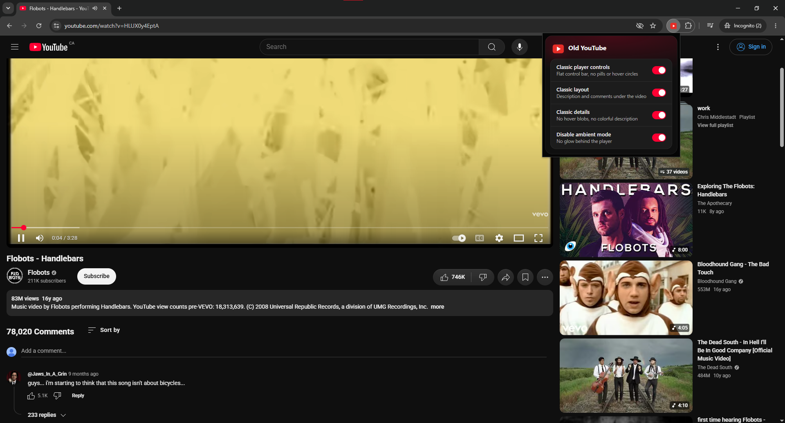

# old-youtube

Vibe coded chromium extension that restores youtube to before the october update moving the comment section to the right.

## What it changes

| Setting | Default | What it does |
| --- | --- | --- |
| Classic player controls | on | Turns off YouTube's `delhi_modern_web_player` flags so the old flat control bar comes back, with no pills, frosted glass or hover circles. Letterboxed videos get black bars |
| Classic layout | on | Turns off the side rail and fixed side panels. Description and comments go back under the video, recommendations back on the right, and theater mode comes back |
| Classic details | on | Plain description box, no oversized player rounding, no grey hover blobs on video cards |
| Disable ambient mode | on | Removes the glow behind the player |

## Install

1. Open `chrome://extensions` (or `edge://extensions`, `brave://extensions`).
2. Turn on **Developer mode**.
3. Click **Load unpacked** and pick this folder.
4. Reload any open YouTube tabs.

Click the toolbar icon to change settings. After a change, a **Reload** button appears that refreshes your YouTube tabs.
